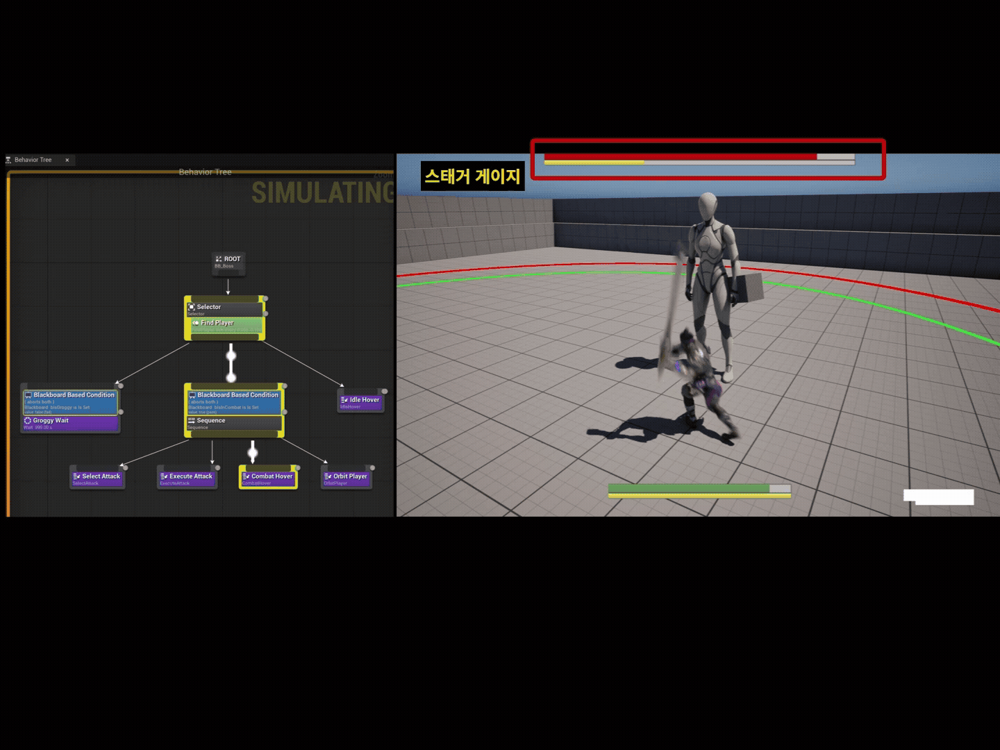
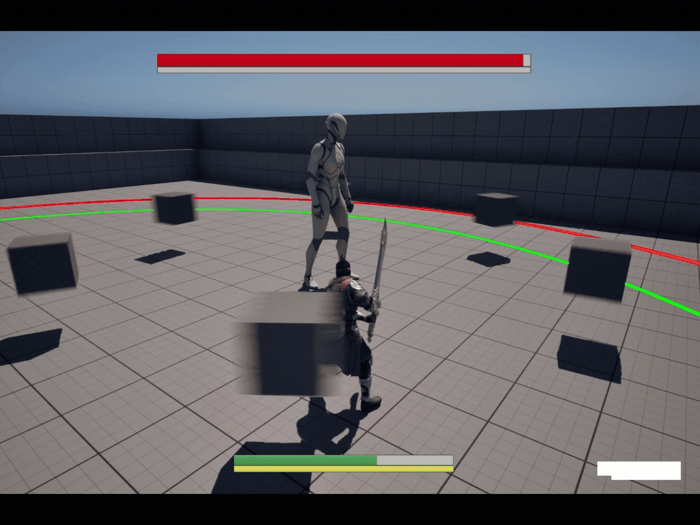
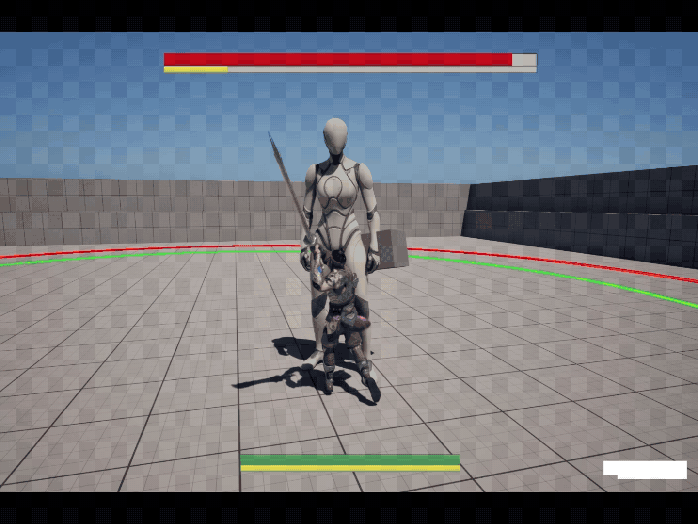

# Eclipse

페이즈에 따라 패턴이 달라지는 3인칭 보스전 액션.


| 장르 | 인원 | 기간 | 엔진 |
|---|---|---|---|
| 3인칭 보스전 액션 | 1인 | 2026.04 — 진행 중 | Unreal Engine 5.7 |


---
## 주요 기능
### 보스
- **3단계 페이즈** — 체력 비율에 따라 전환되며, 페이즈마다 사용 가능한 패턴과 가중치가 달라진다.

- **공격 패턴 3종** — 단현(SilentSlash) · 실음(DiscordDive) · 공명(ResonantWave)

- **가중치 룰렛 선택** — 쿨타임 · 플레이어와의 거리로 걸러낸 뒤 가중치로 추첨한다.

- **스태거 · 그로기** — 피격 시 스태거가 누적되고 임계값에 도달하면 그로기. 임계값은 페이즈와 관계없이 고정이며, 마지막 타 후 5초 지나면 서서히 감소. 그로기 종료 후 잠시 스태거 면역 발생한다.

  
### 전투 공간
- **아레나** — 플레이어 진입을 감지해 전투를 시작하고, 전투 중 이탈을 차단한다.


### 플레이어
- **공격** — 기본 공격 콤보, 특수 공격 2종, 궁극기 <!-- 후에 쿨타임으로 횟수 제한 -->
  - 공격마다 `Startup → Active → Recovery` 단계로 진행된다.
  - **선입력 · 콤보 연계** — 입력 구간(Input Window)에 들어온 입력을 저장했다가 전환 시점에 다음 타로 연계. 연계 트리는 데이터(Transition Table)로 정의한다.
  - **재시작 시점** — 연계가 끊긴 뒤의 입력은 후딜 후반(Restart Point)에 새 공격으로 실행한다.
  - **궁극기** — 예열 · 판정 동안 무적, 후딜부터 캔슬 가능하다.
- **검 판정** — 판정 구간(Hit Window) 동안 검날을 여러 지점으로 나눠 매 프레임 이전 위치 → 현재 위치를 스윕. 빠르게 휘둘러도 판정이 빠지지 않는다.
- **대시** — 대시 중 무적, 공중 대시 1회. 방향입력이 없으면 정면을 유지한 채 백스텝. 공격 중에도 언제든 대시로 캔슬(궁극기는 후딜부터) 가능하다.
- **스태미나** — 대시에 소모 <!-- 후에 쿨타임으로 변경 -->
- **피격 반응** — 공격 강도에 따라 `반응 없음 · 넉백 · 다운` 중 회복 구간(Hit Recovery Window)에 입력을 저장했다가 회복 시점에 즉시 실행된다.
- **공격 방향 · 카메라 보정** — 공격이 시작될 때 보스 쪽으로 몸을 회전. 보스가 화면 밖이거나 각도 차가 크면 카메라를 대각선 구도로 부드럽게 보정하고, 마우스 입력 시 보정 중단된다.


### 전투 흐름
- **GameMode가 시작 · 승리 · 패배 · 재시작을 관리**
- 전투 시작 / 종료 시점을 델리게이트로 알려 UI · 연출 · 사운드가 붙을 수 있도록 분리한다.

---
## 조작법
| 키 | 동작 |
|---|---|
| `W` `A` `S` `D` | 이동 |
| `마우스` | 시점 |
| `Space` | 점프 |
| `좌클릭` | 기본 공격 (콤보) |
| `우클릭` | 대시 (입력 없으면 백스텝) |
| `Q` | 특수 공격 1 |
| `E` | 특수 공격 2 |
| `R` | 궁극기 |

---
## 기술 스택

| | |
|---|---|
| 엔진 | Unreal Engine 5.7 |
| 언어 | C++ · Blueprint |
| AI | Behavior Tree · Blackboard · EQS · NavMesh |
| 애니메이션 | Animation Montage · AnimNotify · Root Motion · Inertialization · IK Retargeter |
| 모듈 | AIModule · GameplayTags · Niagara · UMG · EnhancedInput |
| 개발 툴 | Visual Studio · Git |

---
## 프로젝트 구조

```

Source/Eclipse/
├─ AI/
│  ├─ BossAIController          보스 전용 Blackboard 키 정의
│  ├─ WraithAIController        소환 몬스터 AI (수정필요)
│  ├─ BTTask_SelectAttack       페이즈별 풀에서 패턴 추첨
│  ├─ BTTask_ExecuteAttack      선택된 패턴 실행
│  ├─ BTTask_OrbitPlayer        플레이어 주위 선회
│  └─ BTService_FindPlayer      플레이어 탐색
├─ Character/
│  ├─ BaseCharacter             캐릭터 공통 (체력 · 피격 · 사망 · 무적)
│  ├─ Player/
│  │  ├─ PlayerCharacter        입력 · 피격 반응 · 공격 방향 · 카메라 보정
│  │  ├─ DashComponent          대시 · 공중 대시 · 백스텝 · 대시 무적
│  │  ├─ StaminaComponent       스태미나
│  │  └─ AnimNotifyState_HitRecovery   피격 회복 구간
│  └─ Enemy/
│     ├─ EnemyBase              적 공통
│     ├─ EnemyBoss              보스
│     └─ EnemyMinion            소환 몬스터 (수정필요)
├─ Combat/
│  ├─ Attacks/                  보스 공격 · 플레이어 공격(기본 · 특수 · 궁극기)
│  ├─ PlayerAttackComponent     플레이어 공격 입력 · 선입력 · 연계 · 실행
│  ├─ PlayerAttackBase          플레이어 공격 단계 · 검 판정
│  ├─ PlayerAttackTransitionTable   콤보 연계 트리
│  ├─ AnimNotifyState_HitWindow     판정 구간 (Active)
│  ├─ AnimNotifyState_InputWindow   선입력 구간 · 연계 시점
│  ├─ AnimNotify_RestartPoint       연계가 끊긴 뒤 새 공격 실행 시점
│  ├─ BossAttackBase            보스 공격 공통 인터페이스
│  ├─ BossAttackComponent       보스 공격 소유 · 실행
│  ├─ BossPhaseComponent        페이즈
│  ├─ BossGroggyComponent       스태거 · 그로기
│  └─ BossAttackPoolRow         공격 풀 데이터 규격
├─ Interface/CombatInterface    피격 처리 공통 인터페이스
├─ UI/                          HUD · 체력 · 스태미나 · 스태거 바 · 결과 화면
├─ BossArena                    전투 공간 · 진입 감지 · 이탈 차단
└─ EclipseGameMode              전투 흐름 관리

```

보스 패턴을 추가하려면 `UBossAttackBase`를 상속한 클래스를 만들고, 해당 페이즈의 어택 풀 DataTable(`FBossAttackPoolRow`)에 행을 등록한다.

플레이어 공격을 추가하려면 `UPlayerAttackBase`를 상속한 클래스에 공격 단계(몽타주 · 데미지)를 등록하고, Transition Table에 연계를 추가한다.

---
## 구현
### 보스
#### Behavior Tree (AI)
> 전투가 시작되면 보스는 `SelectAttack-ExecuteAttack-CombatHover-OrbitPlayer` 동작을 반복한다.


#### 스태거 · 그로기
> 공격마다 스태거 수치가 쌓이고, 임계값에 도달하면 그로기에 빠진다. 맞지 않으면 게이지가 서서히 줄어든다.



### 아레나 이탈 차단
> 반경 안에 들어오면 전투가 시작되고, 전투 중에는 경계를 벗어나지 못하고 벽을 따라 미끄러진다.


### 플레이어
> 플레이어 약공격, 강공격, 특수스킬, 궁극기 연계 장면.


> 실제 보스전에서 콤보와 대시 캔슬을 섞어 쓰는 장면.


#### 검 판정
> 매 프레임 검날의 이전 위치 → 현재 위치를 스윕해, 빠른 공격도 판정이 빠지지 않는다. (초록 = 빗나감, 빨강 = 적중)



#### 피격 반응
> 공격 강도에 따라 넉백 · 다운으로 반응한다.


#### 궁극기 무적
> 예열 · 판정 동안 무적이라 보스 공격을 맞아도 끊기지 않는다. 후딜부터 무적이 풀리고 대시로 캔슬할 수 있다.



#### 공격 방향 · 카메라 보정
> 공격하면 보스 쪽으로 몸을 돌리고, 보스가 화면 밖이면 카메라를 대각선 구도로 부드럽게 돌린다. 마우스를 움직이면 보정이 멈춘다.


---
## 빌드
Unreal Engine 5.7과 Visual Studio가 필요하다.

플레이어 외형과 애니메이션은 Fab의 **Paragon: Kwang** 에셋을 사용합니다. 저장소에는 포함되어 있지 않으므로, Fab에서 내려받아 `Content/ParagonKwang` 경로에 추가해야 한다.
